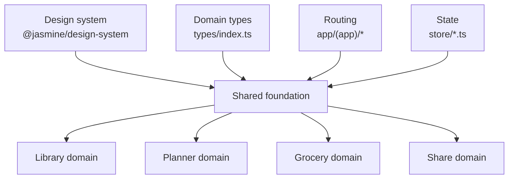
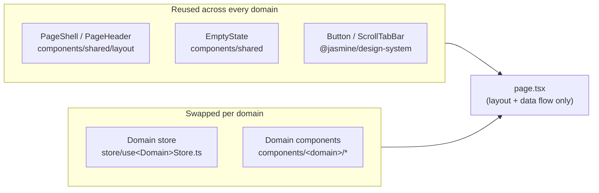
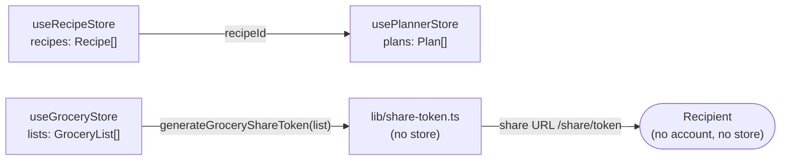

# 01 — Establish the product foundation

Before building any feature, I established the reusable foundation: design-system
components, domain types, routing, and state structure. The codebase is organized
around product domains — Library, Planner, Grocery, Share — rather than individual
screens, so the implementation mirrors the product architecture instead of a flat
list of pages.

## The four foundation pieces

| Piece | Where it lives | What it provides |
|---|---|---|
| Design system | `@jasmine/design-system` (workspace dependency) | Shared Button, Modal, Input, etc. — one visual language, no per-app UI kit |
| Domain types | `types/index.ts` | `Recipe`, `PlanDay`, grocery/category types — the shared vocabulary every store and component builds on |
| Routing | `app/(app)/*` (Next.js App Router) | One route group per domain: `library`, `planner`, `grocery` |
| State | `store/*.ts` (Zustand) | One store per domain, not one global store |

## Organized by domain, not by screen



Every domain draws components, types, routes, and state from the same shared
foundation — nothing is duplicated per screen, and a change to one domain's logic
can't silently ripple into another's.

## Folder structure

```
cookstash/
├─ app/
│  ├─ (app)/
│  │  ├─ layout.tsx
│  │  ├─ library/
│  │  │  ├─ page.tsx
│  │  │  └─ [id]/page.tsx
│  │  ├─ planner/
│  │  │  └─ page.tsx
│  │  └─ grocery/
│  │     └─ page.tsx
│  ├─ (auth)/
│  │  └─ login/page.tsx
│  ├─ api/
│  │  └─ og/route.ts
│  ├─ share/
│  │  ├─ layout.tsx
│  │  └─ [token]/page.tsx
│  ├─ layout.tsx
│  └─ page.tsx
│
├─ components/
│  ├─ library/       ← RecipeCard, RecipeDetail, RecipeGrid, SaveRecipeModal …
│  ├─ planner/        ← CalendarPlanner, FreeformPlanner, DayColumn …
│  ├─ grocery/        ← GroceryList, GroceryItem, CategorySection …
│  ├─ layout/          ← Sidebar, BottomNav
│  └─ shared/          ← EmptyState, Toast, SlideDrawer, TagBadge, ShareView
│     └─ layout/        ← PageShell, PageHeader, ScrollRail, SectionHeader, Stack
│
├─ store/
│  ├─ useAuthStore.ts
│  ├─ useCategoryStore.ts
│  ├─ useGroceryStore.ts
│  ├─ usePlannerStore.ts
│  └─ useRecipeStore.ts
│
├─ types/
│  └─ index.ts
│
└─ lib/
   ├─ og-fetch.ts
   ├─ share-token.ts
   ├─ commonGroceryItems.ts
   ├─ library-labels.ts
   └─ useMediaQuery.ts
```

`components/`, `app/(app)/`, and `store/` all split along the same four domain
lines. Finding "everything about Planner" means opening one folder per concern,
not searching a flat `screens/` directory.

## The domain types, concretely

`types/index.ts` is the shared vocabulary every store, component, and route
builds on. For example, the `Recipe` shape that `useRecipeStore`, `RecipeCard`,
and the `library/` routes all agree on:

```ts
// types/index.ts — mirrors the future DB schema for easy v2 wiring

export interface Recipe {
  id: string
  url: string
  title: string
  thumbnail: string | null
  platform: Platform
  tags: Tag[]
  category: RecipeCategory
  cuisine: string | null
  estimatedCookTime: number | null   // minutes
  notes: string | null
  createdAt: string                  // ISO date string
}
```

ISO date strings and string IDs (rather than `Date` objects or numeric IDs) are a
deliberate choice — the shape mirrors what a future database schema would return,
so wiring up a real backend later doesn't require touching the type definitions.

## Why domains, not screens

- **A screen is a view of a domain, not the unit of reuse.** `library/page.tsx`
  and `library/[id]/page.tsx` are two screens but one domain — they share
  components, the `Recipe` type, and `useRecipeStore`.
- **Isolation.** Because `store/useGroceryStore.ts` only touches grocery state,
  a change to grocery logic can't accidentally break the planner.
- **Consistency.** Every domain follows the same internal shape (`components/<domain>/`,
  a matching store, a matching route group), so once you understand one domain
  you understand the pattern for all of them.

---

# 02 — Build features from reusable components

Features were composed from these domain components rather than built as one-off
screens. This kept the implementation consistent with the product's information
architecture and made patterns reusable across flows.

## The composition pattern

Each route's `page.tsx` is not where UI gets built — it's where a domain store,
a set of domain components, and a shared layout shell get assembled. The page
owns layout and data flow; the components stay focused on presentation.



## The same pattern, three times

The three feature pages don't just look similar — they're built from the literal
same shared pieces, with only the domain-specific slice swapped out:

| Page | Domain store | Domain components | Shared across every page |
|---|---|---|---|
| `library/page.tsx` | `useRecipeStore`, `useCategoryStore` | `FilterBar`, `RecipeCard`, `SaveRecipeModal`, `ManageCategoriesModal`, `ActiveFilterChips` | `PageShell`, `PageHeader`, `EmptyState` |
| `planner/page.tsx` | `usePlannerStore`, `useRecipeStore` | `CalendarPlanner`, `FreeformPlanner`, `PlanTabBar` | `PageShell`, `PageHeader`, `EmptyState` |
| `grocery/page.tsx` | `useGroceryStore` | `GroceryList`, `ShareListButton` | `PageShell`, `PageHeader`, `EmptyState` |

Every feature page imports `PageShell`, `PageHeader`, and `EmptyState` from
`components/shared/`. That's not a coincidence — it's the reusable pattern:
build the shell once, then compose each domain's own components inside it.

## The `library/` domain components

`components/library/` holds eleven components — nothing in `library/page.tsx` is
built inline. Each one owns a single piece of the domain's UI, taking the domain
`Recipe` type (or an id) as its input:

| Component | Signature | Role |
|---|---|---|
| `RecipeGrid` | `({ recipes, onAddRecipe })` | Lays out the filtered/grouped recipe collection |
| `RecipeCard` | `({ recipe })` | One recipe's summary tile inside the grid/rail |
| `RecipeDetail` | `({ recipe })` | Full detail view for a single recipe |
| `RecipeNotes` | `({ recipeId, initialNotes, className })` | Editable notes attached to a recipe |
| `FilterBar` | `({ ... })` | Tag/platform/quick-pick filtering — the primary decision lever |
| `ActiveFilterChips` | `({ ... })` | Removable chips reflecting the filters currently applied |
| `SaveRecipeModal` | `({ onClose })` | Paste-a-link save flow |
| `EditRecipeModal` | `({ recipe, onClose, onDelete })` | Edit an existing recipe's fields |
| `DeleteConfirmModal` | `({ recipeId, recipeTitle, onClose, onCancel })` | Confirm-before-delete guard |
| `AddToPlanModal` | `({ recipeId, onClose })` | Send a saved recipe into the planner |
| `ManageCategoriesModal` | `({ onClose })` | Create/edit/reorder the user's own categories |

None of these know about `PageShell` or the page's layout — `library/page.tsx` is
the only place that decides where each one renders. That's what keeps them
composable: `RecipeCard` doesn't care whether it's rendered in a `ScrollRail` on
the library page or in a future picker inside the planner — it only needs a
`Recipe`.

## One page, concretely

`library/page.tsx` doesn't hand-roll a header, a save button, or a recipe grid —
it composes them from the design system and the `library/` domain components:

```tsx
return (
  <PageShell>
    <PageHeader
      title="Recipe library"
      subtitle={subtitle}
      actions={
        <>
          <Button onClick={() => setShowManageCategories(true)} type="Outline">
            Categories
          </Button>
          <Button onClick={() => setShowSaveModal(true)} type="Primary">
            + Save recipe
          </Button>
        </>
      }
    >
      {/* search input */}
    </PageHeader>

    {/* ...filters, then domain components rendering the actual recipes: */}
    <ScrollRail>
      {recipes.map((recipe) => (
        <ScrollRail.Item key={recipe.id} width={cardWidth}>
          <RecipeCard recipe={recipe} />
        </ScrollRail.Item>
      ))}
    </ScrollRail>
  </PageShell>
)
```

`PageShell`, `PageHeader`, and `Button` are the same primitives `planner/page.tsx`
and `grocery/page.tsx` use — only `RecipeCard` and the data feeding it are specific
to this domain.

## Why compose instead of building one-off screens

- **Consistency with the IA.** Because every page is `PageShell` → `PageHeader` →
  domain content, the product's information architecture (four domains, one shell)
  is enforced by the code structure, not just a design guideline someone has to
  remember to follow.
- **Reusable patterns, not reusable pixels.** `PageShell`/`PageHeader`/`EmptyState`
  aren't copy-pasted per page — they're imported once and reused, so a shell-level
  change (spacing, a new header action slot) updates every domain at once.
- **Pages stay thin.** Business logic (filtering, grouping, derived state) lives in
  the page; rendering stays in components. That split is what makes each domain's
  components easy to reuse or restyle without touching another domain's page.

---

# 03 — Connect components into real interactions

I connected the components through domain-scoped state using Zustand, allowing
actions such as saving a recipe, assigning dishes to a planner, generating a
grocery list, and sharing a plan to work across the product.

## Four actions, four domain stores

Each action is owned by exactly one store — the component that triggers it never
reaches into another domain's state directly:

| Action | Store method | Called from |
|---|---|---|
| Save a recipe | `useRecipeStore.addRecipe(recipe)` | `SaveRecipeModal` |
| Assign a dish to the planner | `usePlannerStore.assignRecipeToSlot(planId, date, mealType, recipeId)` | `AddDishesModal` / `AssignDishModal` |
| Build a grocery list | `useGroceryStore.createList(list)` + `addItem(listId, item)` | `grocery/page.tsx` / `AddItemForm` |
| Share a list | `useGroceryStore.setShareToken(listId, token)` | `ShareListButton` |

## How the domains connect without merging

Stores don't call each other directly. They connect the same way the UI does —
by passing an **id** across the boundary, not a live reference:



`assignRecipeToSlot` takes a `recipeId`, not a `Recipe` object — the planner
stores a pointer into the recipe library, so `useRecipeStore` and
`usePlannerStore` stay decoupled: editing a recipe's title doesn't require
walking every plan to update a copy of it.

## Sharing: state that leaves the store entirely

Sharing a grocery list doesn't call a backend — it serializes the list straight
out of the store into the URL:

```ts
// components/grocery/ShareListButton.tsx
function getShareUrl(): string {
  const t = generateGroceryShareToken(list)   // list → base64url token
  setShareToken(list.id, t)                    // remember it on the store record
  return buildShareUrl(t)                      // → /share/<token>
}
```

```ts
// lib/share-token.ts
export function generateGroceryShareToken(list: GroceryList): string {
  const payload: SharePayload = { type: 'grocery-list', id: list.id, snapshot: list }
  return generateShareToken(payload)
}
```

The recipient's `/share/[token]` route decodes the token straight out of the
URL — no lookup, no account, no shared store:

```ts
// app/share/[token]/page.tsx
const payload = decodeShareToken(token)
if (payload.type === 'grocery-list') {
  return <ShareView type="grocery" list={payload.snapshot} />
}
```

`SharePayload.type` is actually typed as `'meal-plan' | 'grocery-list'` — the
share mechanism was built domain-agnostic on purpose. Grocery lists are the
one wired up today; extending it to full meal plans is a matter of adding one
more branch in the share page, not building a second sharing system.

## Why domain-scoped state, not one global store

- **A change in one domain can't silently break another.** `useGroceryStore`
  only touches grocery state — a bug in list logic can't corrupt the planner
  or the recipe library.
- **Cross-domain links stay explicit.** Passing `recipeId` (not a `Recipe`)
  across the Recipe → Planner boundary means the connection is visible in the
  function signature, not hidden inside a shared blob of state.
- **Sharing works without a backend.** Because a grocery list is a complete,
  self-contained value in its store, it can be serialized whole into a URL —
  no server round-trip needed to reconstruct it on the recipient's side.

---

# 04 — Persist the experience

I persisted domain state locally so recipes, plans, and grocery lists survive
page reloads, giving the prototype a realistic product experience without
requiring a backend.

## Every domain store persists itself

Persistence follows the same domain-scoped pattern as everything else — each
store wraps itself in Zustand's `persist` middleware and owns its own
`localStorage` key, rather than one global "app state" blob:

| Store | `localStorage` key | Schema version | Migrates? |
|---|---|---|---|
| `useRecipeStore` | `cookstash-recipes` | 5 | yes |
| `usePlannerStore` | `cookstash-planner` | 3 | yes (+ custom storage adapter) |
| `useCategoryStore` | `cookstash-categories` | 3 | yes |
| `useGroceryStore` | `cookstash-grocery` | — | no |
| `useAuthStore` | `cookstash-auth` | — | no |

## The base pattern

At its simplest, persistence is just wrapping the store creator in `persist`
with a storage key — `useGroceryStore` is the plainest example:

```ts
// store/useGroceryStore.ts
export const useGroceryStore = create<GroceryStore>()(
  persist(
    (set, get) => ({
      lists: [],
      customItems: [],
      createList: (list) =>
        set((state) => ({ lists: [list, ...state.lists] })),
      // ...
    }),
    { name: 'cookstash-grocery' }
  )
)
```

Zustand handles the read-on-load and write-on-change automatically — the
store's own action functions (`createList`, `addItem`, etc.) don't know or
care that they're backed by `localStorage` at all.

## Schema evolves, data survives: versioned migrations

A prototype's data shape changes as it's built. `useRecipeStore` is on its
5th schema version — `version` and `migrate` let old persisted data get
upgraded in place instead of wiped:

```ts
// store/useRecipeStore.ts
{
  name: 'cookstash-recipes',
  version: 5,
  migrate: (persisted: unknown, version: number) => {
    if (version < 5) {
      const state = persisted as { recipes: Recipe[]; seeded: boolean }
      // Rename category 'other' → 'unsorted' for existing recipes
      const recipes = (state.recipes ?? []).map((r) =>
        r.category === 'other' ? { ...r, category: 'unsorted' } : r
      )
      return { ...state, recipes }
    }
    return persisted
  },
}
```

`usePlannerStore` went through a bigger migration at v2 — converting flat
plan objects into the `CalendarPlan | FreeformPlan` discriminated union
described in [02](#02--build-features-from-reusable-components) — proof this
isn't boilerplate copy-pasted per store; each `migrate` function handles the
real schema change that store went through.

## Guarding against storage failures

`usePlannerStore` also swaps in a custom `storage` adapter instead of the
default, to fail safely if `localStorage` is full rather than crash the app:

```ts
// store/usePlannerStore.ts
storage: {
  getItem: (name) => {
    const raw = localStorage.getItem(name)
    return raw ? JSON.parse(raw) : null
  },
  setItem: (name, value) => {
    try {
      localStorage.setItem(name, JSON.stringify(value))
    } catch {
      localStorage.removeItem(name)
    }
  },
  removeItem: (name) => localStorage.removeItem(name),
},
```

If a write throws (quota exceeded is the realistic case, since plans can grow
large), the adapter drops the stale entry instead of leaving a half-written,
unparsable value behind for the next `getItem` to choke on.

## Why local persistence, not a backend

- **Reloads behave like a real product.** Without persistence, every refresh
  would silently wipe the library, the plan, and the grocery list — the kind
  of thing that makes a prototype feel like a demo instead of a product.
- **No infrastructure required to prove the interaction model.** The MVP's
  goal was validating the save → plan → shop → share loop, not standing up
  a database. `persist` gets reload-safe state for free.
- **The data was already shaped for this.** The domain types (`id: string`,
  `createdAt: string` as ISO dates — see [01](#01--establish-the-product-foundation))
  mirror what a real database record would look like, so a future move from
  `localStorage` to a real backend is a storage-layer swap, not a type
  rewrite.

---

# 05 — Iterate as the product took shape

As the flows became interactive, I used the working prototype to identify
duplicated patterns, unclear interactions, and inconsistencies between
features. I refactored shared components, tightened type definitions, and
consolidated recurring interaction patterns as the product evolved.

## Tightening a type: from loose plan objects to a discriminated union

The `usePlannerStore` migration in [04](#04--persist-the-experience) — "v0/v1 →
v2: convert to discriminated union" — is the trace evidence of an iteration
that happened at the type level. Calendar and freeform plans started out as
one loosely-shaped object; using the prototype surfaced that the two modes
don't actually share fields cleanly, so the type was tightened into a real
discriminated union:

```ts
// types/index.ts
interface BasePlan {
  id: string
  name: string
  createdAt: string
  shareToken: string | null
}

export interface CalendarPlan extends BasePlan {
  mode: 'calendar'
  days: PlanDay[]
}

export interface FreeformPlan extends BasePlan {
  mode: 'freeform'
  dishes: FreeformDish[]
  description: string | null
}

export type MealPlan = CalendarPlan | FreeformPlan
```

`mode` is the discriminant — TypeScript narrows `MealPlan` to the right shape
wherever it's checked, so `days` is only reachable after confirming
`mode === 'calendar'`. The compiler enforces the distinction the earlier loose
object left to convention.

## One field, three schema versions: recipe categories

`CategoryMeta` is a small shape — `id`, `label`, `emoji` — but its catch-all
"uncategorized" entry went through three real, separate iterations, all
visible in `useCategoryStore`'s own migration history:

```ts
// store/useCategoryStore.ts
export interface CategoryMeta {
  id: string       // kebab-case slug, e.g. "main-course" or "korean-bbq"
  label: string    // display name
  emoji: string     // single emoji
}

export const UNSORTED_CATEGORY_ID = 'unsorted'
```

| Version | What changed | Why |
|---|---|---|
| v1 (original) | Catch-all category had `id: 'other'` | Whatever felt natural when categories were first modeled |
| → v2 | `id: 'other'` renamed to `id: 'unsorted'`, `label: 'Inbox'`, `emoji: '📥'` | "Other" reads like a category you chose; "Inbox" reads like a place things land by default — the label was actively misleading users about why a recipe was there |
| → v3 | `label` changed again, independent of `id` | A second pass on the same field — the id was already right, only the copy needed another iteration |
| every version | Re-sorted so the catch-all is always position 0 | Regardless of what it's called, it should always be the first thing a user sees |

The actual `migrate` function shows this as a cascade, not a rewrite — each
version's fix stays scoped to what changed *at that version*, stacked on top
of what came before:

```ts
migrate: (persisted: unknown, version: number) => {
  const state = persisted as CategoryStore
  let cats = state.categories ?? []

  if (version < 2) {
    // Rename "other" → "unsorted" and move to top
    cats = cats.map((c) =>
      c.id === 'other'
        ? { id: UNSORTED_CATEGORY_ID, label: 'Inbox', emoji: '📥' }
        : c
    )
  }

  if (version < 3) {
    // Rename "Unsorted" label → "Inbox" (id stays the same)
    cats = cats.map((c) =>
      c.id === UNSORTED_CATEGORY_ID
        ? { ...c, label: 'Inbox', emoji: '📥' }
        : c
    )
  }

  const rest = cats.filter((c) => c.id !== UNSORTED_CATEGORY_ID)
  const unsorted =
    cats.find((c) => c.id === UNSORTED_CATEGORY_ID) ??
    { id: UNSORTED_CATEGORY_ID, label: 'Inbox', emoji: '📥' }
  return { ...state, categories: [unsorted, ...rest] }
},
```

A user who installed the prototype at v1 and never cleared `localStorage`
still ends up with the current shape — each `if (version < N)` block only
fires for someone who hasn't already passed through it.

**The same rename, twice, in two different stores.** `useRecipeStore`'s own
v5 migration does the identical `'other' → 'unsorted'` rename, but on
`Recipe.category` instead of `CategoryMeta.id` (see [04](#04--persist-the-experience)).
That's the real cost of domain-scoped state from [03](#03--connect-components-into-real-interactions):
`useCategoryStore` and `useRecipeStore` don't share a type-checked foreign
key, so a rename to the category vocabulary has to be migrated in both
stores independently — nothing would have caught it if only one had been
updated.

## A pattern consolidated: one Toast, every domain

Before consolidation, each feature's "saved" / "error" feedback would have
been its own inline UI. Today it's one `useToast` hook backed by a single
`ToastProvider` mounted once at the app shell:

```ts
// app/(app)/layout.tsx
<ToastProvider>{children}</ToastProvider>
```

```ts
// components/library/RecipeNotes.tsx
const { show: showToast } = useToast()
// ...
showToast('Saved')
```

`components/planner/CalendarPlanner.tsx` calls the exact same `useToast()`
hook for its own feedback. Two different domains, one feedback mechanism —
this is what "consolidated recurring interaction pattern" looks like in the
actual code, not just the design.

## What iteration still surfaces: three ways to open an overlay

Iteration is ongoing, not a one-time cleanup pass — and the codebase today
still shows exactly the kind of inconsistency this step is meant to catch.
Three different overlay implementations currently coexist for what is, from a
user's perspective, the same interaction ("a panel opens over the page"):

| Component | Overlay mechanism |
|---|---|
| `EditRecipeModal`, `DeleteConfirmModal` | `Modal` from `@jasmine/design-system` |
| `GroceryList`'s quick-add panel | `SlideDrawer` (`components/shared`) |
| `SaveRecipeModal`, `ManageCategoriesModal`, `AddToPlanModal` | hand-rolled `fixed inset-0 z-60` |
| `AssignDishModal` | hand-rolled `fixed inset-0 z-50` |

The two hand-rolled versions don't even agree with each other — one is
`z-60`, the other `z-50`. This is precisely the kind of thing a static design
mock can't reveal: it only became visible by using the real, interactive
prototype and hitting both flows back to back. The fix (migrating every
overlay onto the shared `Modal`, or extending it to cover the drawer case) is
the next concrete refactor this step points to.

## Why iterate on a working prototype

- **Duplication only becomes visible in use.** Two hand-rolled overlays look
  harmless in isolation; using both flows back to back is what surfaces that
  they've quietly drifted (`z-60` vs `z-50`).
- **Types can encode a decision, not just describe data.** The `CalendarPlan
  | FreeformPlan` union doesn't just store the same information more
  strictly — it makes the "these are two different things" decision
  impossible to accidentally violate.
- **Consolidation compounds.** Once `useToast` existed for one feature, adding
  it to the next was near-free — the second and third adoptions are what turn
  a one-off helper into an actual pattern.
